# Royal Chain Wallet — Database ER Diagram

Source of truth: `supabase/migrations/00000000000001_royal_chain_core_schema.sql`
(+ `00000000000002_rate_limiting.sql`). Verified against a local disposable
Postgres 16 instance — see `docs/PRODUCTION_READINESS.md` for what that
verification did and didn't cover.

```mermaid
erDiagram
    USERS ||--o{ DEVICES : owns
    USERS ||--o{ SESSIONS : has
    USERS ||--o{ WALLETS : owns
    USERS ||--o{ CONTACTS : has
    USERS ||--o{ NOTIFICATIONS : receives
    USERS ||--o{ KYC_REQUESTS : submits
    USERS ||--o{ FRAUD_CASES : "may be subject of"

    WALLETS ||--o{ WALLET_ACCOUNTS : has
    WALLETS ||--o{ TRANSACTIONS : has
    WALLETS ||--o{ SWAP_HISTORY : has
    WALLETS ||--o{ STAKING_POSITIONS : has

    WALLET_ACCOUNTS ||--o{ BALANCES : has
    ASSETS ||--o{ BALANCES : "priced as"
    ASSETS ||--o{ TRANSACTIONS : "denominates"
    ASSETS ||--o{ TREASURY_POOLS : "held as"

    STAKING_POSITIONS ||--o{ STAKING_REWARDS : accrues
    VALIDATORS ||--o{ STAKING_POSITIONS : delegates

    CONTACTS ||--o{ BENEFICIARIES : has

    ROLES ||--o{ ROLE_PERMISSIONS : grants
    PERMISSIONS ||--o{ ROLE_PERMISSIONS : "granted via"
    ROLES ||--o{ ADMIN_USERS : assigned
    ADMIN_USERS ||--o{ AUDIT_LOGS : performs
    ADMIN_USERS ||--o{ KYC_REQUESTS : reviews

    KYC_REQUESTS ||--o{ KYC_DOCUMENTS : contains

    WALLET_ACCOUNTS ||--o{ LEDGER_ACCOUNTS : has
    ASSETS ||--o{ LEDGER_ACCOUNTS : denominates
    LEDGER_ACCOUNTS ||--o{ LEDGER_ENTRIES : has
    TRANSACTIONS ||--o{ LEDGER_ENTRIES : "posts (balanced)"
    CURRENCIES ||--o{ EXCHANGE_RATES : "quoted in"

    LEDGER_ACCOUNTS {
        uuid id PK
        uuid wallet_account_id FK
        uuid asset_id FK
        text account_type "user | system"
        text system_key
    }
    LEDGER_ENTRIES {
        uuid id PK
        uuid transaction_id FK
        uuid ledger_account_id FK
        text direction "debit | credit"
        numeric amount "always positive"
    }
    CURRENCIES {
        text code PK
        text name
        text symbol
        int decimals
    }
    EXCHANGE_RATES {
        uuid id PK
        text base_currency FK
        text quote_currency FK
        numeric rate
        text source
    }

    USERS {
        uuid id PK
        uuid auth_user_id
        text email
        text preferred_currency
        text preferred_locale
        text kyc_status
    }
    WALLETS {
        uuid id PK
        uuid user_id FK
        text label
        boolean is_primary
    }
    WALLET_ACCOUNTS {
        uuid id PK
        uuid wallet_id FK
        text chain
        text address
        text derivation_path
    }
    ASSETS {
        uuid id PK
        text symbol
        text chain
        text standard
        int decimals
        text contract_address
    }
    BALANCES {
        uuid id PK
        uuid wallet_account_id FK
        uuid asset_id FK
        numeric amount
        numeric usd_value
    }
    TRANSACTIONS {
        uuid id PK
        uuid wallet_id FK
        uuid asset_id FK
        text chain
        text direction
        text kind
        numeric amount
        text status
        text tx_hash
    }
    SWAP_HISTORY {
        uuid id PK
        uuid wallet_id FK
        uuid from_asset_id FK
        uuid to_asset_id FK
        numeric rate
        text status
    }
    VALIDATORS {
        uuid id PK
        text name
        numeric apy_pct
    }
    STAKING_POSITIONS {
        uuid id PK
        uuid wallet_id FK
        uuid asset_id FK
        uuid validator_id FK
        numeric amount
        text status
    }
    STAKING_REWARDS {
        uuid id PK
        uuid staking_position_id FK
        numeric amount
        boolean claimed
    }
    CONTACTS {
        uuid id PK
        uuid user_id FK
        text name
    }
    BENEFICIARIES {
        uuid id PK
        uuid contact_id FK
        text chain
        text address
    }
    NOTIFICATIONS {
        uuid id PK
        uuid user_id FK
        text kind
        text title
        boolean read
    }
    TREASURY_POOLS {
        uuid id PK
        uuid asset_id FK
        numeric amount
        numeric usd_value
    }
    ROLES {
        uuid id PK
        text key
        text name
    }
    PERMISSIONS {
        uuid id PK
        text key
    }
    ROLE_PERMISSIONS {
        uuid role_id FK
        uuid permission_id FK
    }
    ADMIN_USERS {
        uuid id PK
        uuid role_id FK
        text email
        boolean is_active
    }
    FRAUD_CASES {
        uuid id PK
        uuid user_id FK
        text severity
        text status
    }
    AUDIT_LOGS {
        uuid id PK
        uuid actor_admin_id FK
        text action
        text target
    }
    SYSTEM_LOGS {
        uuid id PK
        text level
        text source
    }
    KYC_REQUESTS {
        uuid id PK
        uuid user_id FK
        text status
        uuid reviewer_admin_id FK
    }
    KYC_DOCUMENTS {
        uuid id PK
        uuid kyc_request_id FK
        text doc_type
        text storage_path
    }
    ANALYTICS_EVENTS {
        uuid id PK
        uuid user_id FK
        text event_name
    }
    SESSIONS {
        uuid id PK
        uuid user_id FK
        uuid device_id FK
        timestamptz expires_at
    }
    DEVICES {
        uuid id PK
        uuid user_id FK
        boolean is_trusted
    }
    SETTINGS {
        text key PK
        jsonb value
    }
```

**Not shown above:** `rate_limit_events` (migration 2) — intentionally
not linked to any other table; an anonymous append-only log keyed by a
free-form `bucket_key` string, not a foreign key relationship.

**Ledger integrity (Phase 9, migrations 3-4):** every row in
`ledger_entries` is only ever written via `post_ledger_entries()` or the
atomic `record_transaction_with_ledger()` function — both reject (and
roll back) any set of entries where sum(debits) ≠ sum(credits) for a
transaction. `balances.amount` (migration 1) is now a trigger-maintained
cache of `sum(credits) - sum(debits)` per ledger account — application
code must never `UPDATE balances` directly. This was verified against a
local disposable Postgres, not the live database; see
`docs/PRODUCTION_READINESS.md`.

**RLS status:** enabled on `users`, `wallets`, `wallet_accounts`,
`balances`, `transactions`, `swap_history`, `staking_positions`,
`staking_rewards`, `contacts`, `beneficiaries`, `notifications`,
`devices`, `sessions`, `kyc_requests`, `kyc_documents`,
`rate_limit_events`, `ledger_accounts`, `ledger_entries` — all with
**zero policies**, meaning deny-all by default until per-user policies
are added.
